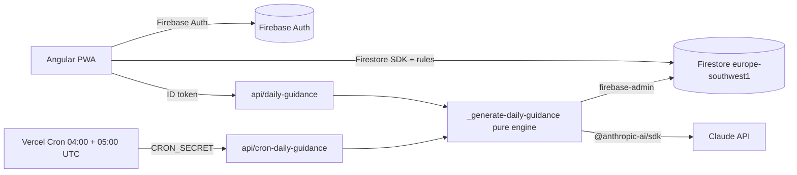

# 02 — Architecture

Same foundations as framedBySanti (Angular 22 + Vite + Transloco on Vercel, Firebase), plus a scheduled AI engine in Vercel Functions.

## Overview



## Decisions

| Topic | Decision | Why |
|-------|----------|-----|
| Backend | Firebase (Auth + Firestore) | Same as framedBySanti; realtime updates between two trainers; offline cache for the roadmap |
| Region | Firestore `europe-southwest1` (Madrid) | Users in ES/PT, EU data residency |
| Auth | Email link (passwordless) + Google | Invitation email is the sign-in link itself; no email provider needed |
| Data access (client) | Firebase modular SDK, only in `src/app/data/` | Realtime `onSnapshot` for today's tasks; repositories hide the SDK from features |
| Data access (server) | `firebase-admin` with a service account (`FIREBASE_SERVICE_ACCOUNT` env, JSON) | Cron runs without a user token; admin writes guidance (clients cannot) |
| Server code | Vercel Functions in `api/`, pattern `_name.ts` (pure, injected deps, tested) + `name.ts` (thin wrapper) | Same as framedBySanti |
| AI | `@anthropic-ai/sdk`, model from `CLAUDE_MODEL` (default `claude-opus-5-5`), structured outputs | Key stays server-side; see `04-guidance-engine.md` |
| Schedule | Vercel Cron, two daily entries | Works on Hobby (once per day per job, ±59 min precision) |
| Types | Hand-written domain types + converters that validate | No codegen for Firestore; rules enforce shapes |
| i18n | Transloco with `es` (Castilian Spanish, default), `pt` (European Portuguese) and `en` (US English); `Intl` locales `es-ES`, `pt-PT` and `en-US` for dates, numbers and plural rules | Spain and Portugal from day one, US English from H1; a browser in English starts in `en`, anything unsupported in `es` |
| Theme | Dark by default, always: never derived from `prefers-color-scheme`. A per-device switch (`ThemeStore`, `localStorage` key `dela-theme`) turns light on; an inline script in `index.html` applies a stored `light` before the first paint, and critical inline styles paint the background before the stylesheet arrives | Product decision (outdoor use at dawn and night); no white flash on a dark app |
| Fonts | Figtree (body) and Bricolage Grotesque (display), variable, latin subset, self-hosted in `public/assets/fonts/` (SIL OFL, licence next to each file), `font-display: swap`; the body font is preloaded | No font CDN connection or render-blocking stylesheet; stable text while fonts load |
| Motion | Route changes use View Transitions (`withViewTransitions`): a short cross-fade; same-page navigations and `prefers-reduced-motion: reduce` skip it (`core/utils/view-transition.ts`). A hidden page never starts one (the browser aborts it with `InvalidStateError`): `startTransitionsOnlyWhenVisible` applies the change directly, and aborted theme reveals are caught. The theme button reveals the new theme in a circle from the click point. Controls animate with `--duration-fast`; all motion is off under reduced motion | Calm, flash-free navigation |
| Photos | Cloudinary: signed direct upload (`api/sign-upload`, same pattern as framedBySanti), per-household folder, delivery with `f_auto,q_auto` and srcset | Free tier, optimized delivery, no Firebase Storage plan needed |
| Videos | YouTube **unlisted** links; only the 11-char video id is stored; facade (thumbnail, then `youtube-nocookie.com` player on tap) | No video hosting cost; private YouTube videos cannot be embedded |
| Catalogs | Bundled JSON (`seed/`) imported by the app and by `api/`; text via Transloco keys | Static, global, versioned in git: no Firestore reads, rules or seed script |
| PWA | `@angular/service-worker` (`ngsw-config.json`) + `public/site.webmanifest`; registered only in production builds (`core/pwa/service-worker.ts`); `core/pwa/app-update.store.ts` reloads on an unrecoverable worker and shows an update banner on `VERSION_READY`; `scripts/check-ngsw.mjs` checks the worker output after every build | Installable; app shell and translations cached for offline use; `/api/*` never cached; returning users get new deploys without losing an unsaved log |

> Verified during H1 setup: `@angular/service-worker` works with the Analog Vite plugin without the Angular CLI builder. The `angular-service-worker` plugin in `vite.config.ts` runs after `vite build` (`closeBundle`): it copies `ngsw-worker.js` and `safety-worker.js` into `dist/` and runs the package's `ngsw-config` CLI, which hashes the built files into `dist/ngsw.json`. `ngsw-config.json` prefetches the app shell (`index.html`, `/assets/*.js|css`, `/assets/i18n/*.json`, manifest, favicons), loads icons lazily, keeps the navigation fallback to `/index.html` and excludes `/api/**` from it; there are no `dataGroups`, so API responses always go to the network. `vite-plugin-pwa` was not needed.
>
> Updates: `AppUpdateStore` starts at bootstrap (`provideAppInitializer` in `provideAppServiceWorker`) and only subscribes when `SwUpdate.isEnabled`. An `unrecoverable` event (the cached version references files the browser evicted) reloads the page. A `VERSION_READY` event never reloads on its own, because a trainer may be mid-log: it sets `updateReady`, the shell shows a banner (`pwa.updateReady`, `pwa.reload`) and the button activates the new version and then reloads.
>
> `npm run build` runs `vite build && node scripts/check-ngsw.mjs`. The check fails the build unless `dist/ngsw.json`, `dist/ngsw-worker.js` and `dist/safety-worker.js` exist, `index` is `/index.html`, `navigationUrls` has a negative rule excluding `/api/`, no asset or data group matches `/api`, and both translation files are in a prefetch asset group.
>
> The install prompt and offline behaviour can only be checked on a deployed build (Vercel preview): the worker never registers under `vite` dev or Vitest.

## Layers

| Layer | Contains | May import |
|-------|----------|------------|
| `domain/` | Types (`Dog`, `GuidanceTask`, `TaskLog`…), pure rules: age in weeks, plan week, success rate, guidance validation, health flags, Madrid date | nothing from the app |
| `data/` | `HouseholdRepository`, `DogRepository`, `GuidanceRepository`, `LogRepository`; converters. Catalogs are read from `seed/` through `domain/catalog.ts` (typed, no I/O) | `domain`, `firebase/*` |
| `features/` | Containers and pages per story; signal stores | `domain`, `data`, `shared` |
| `shared/` | Presentational components (task card, slot section, reaction picker, success counter) | `domain` types only |
| `core/` | Firebase app init, auth session store, Transloco loader, error handler | `domain`, `data` |
| `api/` | Engine and endpoints | `src/app/domain` (pure), `firebase-admin`, `@anthropic-ai/sdk` |

## Auth and session

- `AuthSessionStore` (`core/session/`, signals): `user`, `profile`, `household`, `dog`, `invitations`, `error`, `status` (`loading | signedOut | needsHousehold | needsDog | ready | unavailable`). It talks to Firebase Auth through `AUTH_GATEWAY` (`core/auth/`, a seam that keeps the store testable) and to Firestore only through the repositories.
- On sign-in it first checks the user's own allowlist entry (`AccessRepository.hasAccess`, `allowedEmails/{email}`); an account outside the allowlist is signed out with `error = notAllowed` and the sign-in screen says it has no access. Then it runs `ensureProfile` with the UI language, applies the profile locale, then follows the user's household (`watchForMember`) and its dog (`watchAll`), or loads pending invitations when there is no household. The status stays `loading` until the dog list of the current household arrives, so it never reports `needsDog` for a moment. When the session fails to load, a lookup map classifies the error. Only errors proving the session itself is invalid (`auth/user-token-expired`, `auth/user-disabled`, `auth/invalid-user-token`, `auth/invalid-refresh-token`, Firestore `permission-denied` or `unauthenticated`, the dogs query only after its bounded retry) sign the user out with `error = sessionFailed`. Anything else (`unavailable`, `deadline-exceeded`, network errors, a profile that does not load within 10 s, unknown errors) keeps the Firebase user signed in and sets `status = unavailable`, then asks the auth server whether the account still exists (`AUTH_GATEWAY.verifyUser`, Firebase `reload`): a deleted or revoked account (`auth/user-not-found` and the invalid codes above) is signed out with `error = sessionFailed` instead of staying stuck on the notice, and an unreachable auth server keeps it. Meanwhile the root shows a calm full-screen notice under the header with a Retry button that reloads the session (`retry()`), and the session also retries on its own when the browser fires `online`. Users train on a farm with weak coverage, so a bad connection must never cost a new sign-in link. Right after creating or joining a household the dogs query is retried briefly while the membership reaches the server.
- Sign-in: email link (`sendSignInLinkToEmail` with continue URL `/login`; the email is remembered in `localStorage` for the same-device flow and asked again on another device) and Google (`signInWithPopup`).
- Each route declares the statuses it serves (`sessionRoute([...])` in `app.routes.ts`); `sessionGuard` waits until the status is neither `loading` nor `unavailable` (an unavailable session is never redirected to `/login`) and redirects to the screen of the current status: `/login`, `/household/new` (or `/invitations` when invitations are pending), `/dog/new`, `/today`. `/household` (members, invitations, preferences) serves `needsDog` and `ready`. `provideSessionRedirect` moves the user when the status changes on the same screen (signed in, household created, invitation accepted, signed out). While the status is `loading` or a navigation is pending, the root shows a calm surface instead of the previous screen.
- Layout: one sticky site header on every screen (same pattern as the portfolio and framedBySanti): brand on the left; from 768px the navigation (`Today`, `Household`, only once the status is `ready`), the language pills (flag + code), the theme button and sign-out (when signed in) sit in the bar; below 768px they move to a panel behind a menu button (`aria-expanded`/`aria-controls`, Escape closes and returns focus, closes on navigation, page scroll locked while open). There is no side or bottom navigation. Onboarding screens are single-column under the header.
- Invitations: owner writes `households/{hid}/invitations/{email}` then calls `sendSignInLinkToEmail(email)`. On sign-in, the client runs a collection-group query on `invitations` where `email == auth.email` (allowed by rules only for the owner of that email).

## Daily guidance scheduling (UTC and DST)

Vercel Cron schedules are UTC. 06:00 in Madrid is 05:00 UTC in winter (CET) and 04:00 UTC in summer (CEST).

```json
{ "crons": [
  { "path": "/api/cron-daily-guidance", "schedule": "0 4 * * *" },
  { "path": "/api/cron-daily-guidance", "schedule": "0 5 * * *" }
] }
```

Handler algorithm:

1. Reject unless `Authorization === Bearer ${CRON_SECRET}`.
2. `now` → Madrid local date and hour with `Intl.DateTimeFormat('en-CA', { timeZone: 'Europe/Madrid' })` (domain function `madridClock(now)`, unit tested on both DST change days: 2027-03-28 and 2026-10-25).
3. If Madrid hour < 6 → return `skipped: too-early` (winter 04:00 UTC run).
4. For each eligible dog: if `dailyGuidance/{madridDate}` exists → skip; else generate.

Result: in winter the 05:00 UTC job generates; in summer the 04:00 UTC job generates and the 05:00 one finds it done. On Hobby, the ±59 min precision means guidance lands between 06:00 and 06:59 Madrid; Pro gives minute precision. AC2.4 (the client-side template, later on-demand generation) covers any gap.

Phase 2 (Portugal, `Europe/Lisbon`, one hour behind): store `timezone` per household and run the cron hourly (Pro), generating for households whose local hour is 6.

## Endpoints

| Path | Auth | Purpose |
|------|------|---------|
| `GET /api/cron-daily-guidance` | `CRON_SECRET` | Batch generation for all eligible dogs |
| `POST /api/sign-upload` `{ householdId }` | Firebase ID token + membership check | Short-lived Cloudinary signature for one photo upload into `dela/<householdId>/`, images only, ≤ 10 MB |
| `POST /api/delete-media` `{ householdId, dogId, mediaId }` | Firebase ID token + author check | Deletes the media document and its Cloudinary asset |
| `POST /api/daily-guidance` `{ dogId }` | Firebase ID token (`verifyIdToken`) + membership check | On-demand generation for today (idempotent) |

Both return `Cache-Control: no-store` and never return the AI raw output.

## Environment variables

| Name | Where | Notes |
|------|-------|-------|
| `NG_APP_FIREBASE_*` | Client (public config) | apiKey, authDomain, projectId, appId |
| `FIREBASE_SERVICE_ACCOUNT` | Server only | Service account JSON |
| `ANTHROPIC_API_KEY` | Server only | Never prefixed with `NG_APP_` |
| `CLAUDE_MODEL` | Server only | Default `claude-opus-5-5` |
| `CRON_SECRET` | Server only | Vercel sends it as Bearer on cron calls |
| `NG_APP_CLOUDINARY_CLOUD_NAME` | Client (public) | Builds delivery URLs |
| `CLOUDINARY_API_KEY`, `CLOUDINARY_API_SECRET` | Server only | Sign uploads, delete assets |

## Testing strategy

| Level | Tool | What |
|-------|------|------|
| Domain | Vitest | All pure rules, table-driven; DST cases; validator rejects unsafe output |
| API handlers | Vitest with injected fakes (clock, Firestore port, Claude port) | Idempotency, fallback, auth rejection |
| Security rules | `@firebase/rules-unit-testing` + Firestore emulator (`npm run test:rules`, `test/rules/`, project `demo-dela`) | Household isolation, invitation join, author-only edits |
| Components | Vitest + JSDOM | Presentational components, stores |

## Deployment

- Vercel project: `buildCommand: npm run build` (so Vercel also runs the service worker smoke check), `outputDirectory: dist`, SPA rewrite `/((?!api/|assets/).*) → /index.html` (as framedBySanti), crons above.
- Firestore rules and indexes deployed with `firebase deploy --only firestore` from `firestore.rules` and `firestore.indexes.json`.
- Catalogs ship inside the bundles (app and functions); a unit test checks that every catalog key has its `en`, `es` and `pt` Transloco entries.
- The engine resolves catalog and health texts for the household locale by importing `public/assets/i18n/{es,pt}.json` in `api/`.
