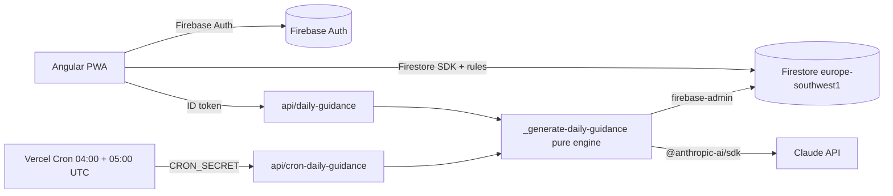

# 02 — Architecture

Same foundations as framedBySanti (Angular 22 + Vite + Transloco on Vercel, Firebase), plus a scheduled AI engine in Vercel Functions.

## Overview



## Decisions

| Topic | Decision | Why |
|-------|----------|-----|
| Backend | Firebase (Auth + Firestore) | Same as framedBySanti; realtime updates between two trainers; offline cache for the roadmap |
| Region | Firestore `europe-southwest1` (Madrid) | Users in ES/PT, EU data residency |
| Auth | Email link (passwordless) + Google | Invitation email is the sign-in link itself; no email provider needed |
| Data access (client) | Firebase modular SDK, only in `src/app/data/` | Realtime `onSnapshot` for today's tasks; repositories hide the SDK from features |
| Data access (server) | `firebase-admin` with a service account (`FIREBASE_SERVICE_ACCOUNT` env, JSON) | Cron runs without a user token; admin writes guidance (clients cannot) |
| Server code | Vercel Functions in `api/`, pattern `_name.ts` (pure, injected deps, tested) + `name.ts` (thin wrapper) | Same as framedBySanti |
| AI | `@anthropic-ai/sdk`, model from `CLAUDE_MODEL` (default `claude-opus-5-5`), structured outputs | Key stays server-side; see `04-guidance-engine.md` |
| Schedule | Vercel Cron, two daily entries | Works on Hobby (once per day per job, ±59 min precision) |
| Types | Hand-written domain types + converters that validate | No codegen for Firestore; rules enforce shapes |
| i18n | Transloco with `es` (Castilian Spanish, default) and `pt` (European Portuguese); `Intl` locales `es-ES` and `pt-PT` for dates and numbers | Spain and Portugal from day one; English later without schema changes |
| Catalogs | Bundled JSON (`seed/`) imported by the app and by `api/`; text via Transloco keys | Static, global, versioned in git: no Firestore reads, rules or seed script |
| PWA | `@angular/service-worker` (`ngsw-config.json`) + `public/site.webmanifest`; registered only in production builds (`core/pwa/service-worker.ts`) | Installable; app shell and translations cached for offline use; `/api/*` never cached |

> Verified during H1 setup: `@angular/service-worker` works with the Analog Vite plugin without the Angular CLI builder. The `angular-service-worker` plugin in `vite.config.ts` runs after `vite build` (`closeBundle`): it copies `ngsw-worker.js` and `safety-worker.js` into `dist/` and runs the package's `ngsw-config` CLI, which hashes the built files into `dist/ngsw.json`. `ngsw-config.json` prefetches the app shell (`index.html`, `/assets/*.js|css`, `/assets/i18n/*.json`, manifest, favicons), loads icons lazily, keeps the navigation fallback to `/index.html` and excludes `/api/**` from it; there are no `dataGroups`, so API responses always go to the network. `vite-plugin-pwa` was not needed.
>
> The install prompt and offline behaviour can only be checked on a deployed build (Vercel preview): the worker never registers under `vite` dev or Vitest.

## Layers

| Layer | Contains | May import |
|-------|----------|------------|
| `domain/` | Types (`Dog`, `GuidanceTask`, `TaskLog`…), pure rules: age in weeks, plan week, success rate, guidance validation, health flags, Madrid date | nothing from the app |
| `data/` | `HouseholdRepository`, `DogRepository`, `GuidanceRepository`, `LogRepository`; converters. Catalogs are read from `seed/` through `domain/catalog.ts` (typed, no I/O) | `domain`, `firebase/*` |
| `features/` | Containers and pages per story; signal stores | `domain`, `data`, `shared` |
| `shared/` | Presentational components (task card, slot section, reaction picker, success counter) | `domain` types only |
| `core/` | Firebase app init, auth session store, Transloco loader, error handler | `domain`, `data` |
| `api/` | Engine and endpoints | `src/app/domain` (pure), `firebase-admin`, `@anthropic-ai/sdk` |

## Auth and session

- `AuthSessionStore` (signals): `user`, `household`, `dog`, `status` (`loading | signedOut | needsHousehold | needsDog | ready`).
- Route guards read `status` and redirect: `/login`, `/household/new`, `/dog/new`, `/today`.
- Invitations: owner writes `households/{hid}/invitations/{email}` then calls `sendSignInLinkToEmail(email)`. On sign-in, the client runs a collection-group query on `invitations` where `email == auth.email` (allowed by rules only for the owner of that email).

## Daily guidance scheduling (UTC and DST)

Vercel Cron schedules are UTC. 06:00 in Madrid is 05:00 UTC in winter (CET) and 04:00 UTC in summer (CEST).

```json
{ "crons": [
  { "path": "/api/cron-daily-guidance", "schedule": "0 4 * * *" },
  { "path": "/api/cron-daily-guidance", "schedule": "0 5 * * *" }
] }
```

Handler algorithm:

1. Reject unless `Authorization === Bearer ${CRON_SECRET}`.
2. `now` → Madrid local date and hour with `Intl.DateTimeFormat('en-CA', { timeZone: 'Europe/Madrid' })` (domain function `madridClock(now)`, unit tested on both DST change days: 2027-03-28 and 2026-10-25).
3. If Madrid hour < 6 → return `skipped: too-early` (winter 04:00 UTC run).
4. For each eligible dog: if `dailyGuidance/{madridDate}` exists → skip; else generate.

Result: in winter the 05:00 UTC job generates; in summer the 04:00 UTC job generates and the 05:00 one finds it done. On Hobby, the ±59 min precision means guidance lands between 06:00 and 06:59 Madrid; Pro gives minute precision. AC2.4 (on-demand generation) covers any gap.

Phase 2 (Portugal, `Europe/Lisbon`, one hour behind): store `timezone` per household and run the cron hourly (Pro), generating for households whose local hour is 6.

## Endpoints

| Path | Auth | Purpose |
|------|------|---------|
| `GET /api/cron-daily-guidance` | `CRON_SECRET` | Batch generation for all eligible dogs |
| `POST /api/daily-guidance` `{ dogId }` | Firebase ID token (`verifyIdToken`) + membership check | On-demand generation for today (idempotent) |

Both return `Cache-Control: no-store` and never return the AI raw output.

## Environment variables

| Name | Where | Notes |
|------|-------|-------|
| `NG_APP_FIREBASE_*` | Client (public config) | apiKey, authDomain, projectId, appId |
| `FIREBASE_SERVICE_ACCOUNT` | Server only | Service account JSON |
| `ANTHROPIC_API_KEY` | Server only | Never prefixed with `NG_APP_` |
| `CLAUDE_MODEL` | Server only | Default `claude-opus-5-5` |
| `CRON_SECRET` | Server only | Vercel sends it as Bearer on cron calls |

## Testing strategy

| Level | Tool | What |
|-------|------|------|
| Domain | Vitest | All pure rules, table-driven; DST cases; validator rejects unsafe output |
| API handlers | Vitest with injected fakes (clock, Firestore port, Claude port) | Idempotency, fallback, auth rejection |
| Security rules | `@firebase/rules-unit-testing` + Firestore emulator | Household isolation, invitation join, author-only edits |
| Components | Vitest + JSDOM | Presentational components, stores |

## Deployment

- Vercel project: `buildCommand: vite build`, `outputDirectory: dist`, SPA rewrite `/((?!api/|assets/).*) → /index.html` (as framedBySanti), crons above.
- Firestore rules and indexes deployed with `firebase deploy --only firestore` from `firestore.rules` and `firestore.indexes.json`.
- Catalogs ship inside the bundles (app and functions); a unit test checks that every catalog key has its `es` and `pt` Transloco entries.
- The engine resolves catalog and health texts for the household locale by importing `public/assets/i18n/{es,pt}.json` in `api/`.
