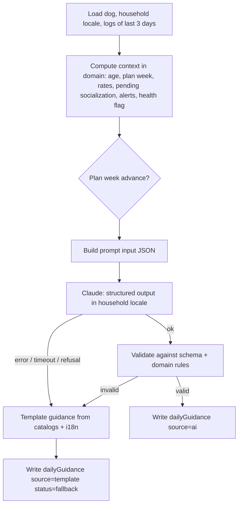

# 04 — Daily guidance engine

`api/_generate-daily-guidance.ts` (pure, injected ports) behind two wrappers: `api/cron-daily-guidance.ts` and `api/daily-guidance.ts`. Code decides **what is allowed**; Claude decides **how to phrase and pick** within those limits; a validator checks the result; the template is the safety net.

## Flow



## Inputs (computed in `domain/`, never by the model)

| Input | Rule |
|-------|------|
| `locale` | Household locale (`es` → Castilian Spanish, `pt` → European Portuguese, `en` → US English) |
| `ageWeeks` | `floor((madridDate − birthDate) / 7 days)` |
| `planWeek` | Current `dog.planWeek`, possibly advanced (see below); never more than `ageWeeks − 7` (week 1 at 8 weeks) and never > 8 |
| `weekPlan` | `seed/plan-weeks.json` entry: objective, how, readyWhen (canonical English), `keySkills`, `focusSkills` |
| `cues` | Spoken cue word per skill in the household locale, from `catalog.skills.<key>.cue` and `catalog.cues.*` |
| `recentLogs` | Task and socialization logs of the last 3 Madrid days, with trainer display names (no uids) |
| `skillRates` | Per skill over the **evaluation window**: the most recent 10 training attempts within the last 7 days. `rate = successes / attempts`; `null` when fewer than 10 attempts |
| `masteredSkills` | Skills with `rate ≥ 0.8`, plus `name` from week 2 on |
| `strugglingSkills` | Skills with `rate < 0.5` (non-null) |
| `pendingSocialization` | Catalog items without a `calm` or `curious` log; items whose last reaction is `fear` are listed separately as `toRepeatGently` |
| `careAlerts` | Active alerts for the Madrid month, filtered by `sleepsOutdoors`, `environment` and `arrivalWeek`; message resolved in the household locale |
| `sleepsOutdoors`, `environment` | From the dog |
| `healthFlag` | `domain/health-flag.ts` over notes of the last 3 days: `urgent` \| `vet` \| `null` |

### Plan week advance (deterministic)

Advance from `planWeek` to `planWeek + 1` only when **all** `keySkills` of the current week have `rate ≥ 0.8` and the age cap allows it. Otherwise stay. Never go back automatically. The advance is written to `dog.planWeek` by the server in the same transaction as the guidance.

## Engine rules (enforced by the validator, stated in the prompt)

| Rule | Check |
|------|-------|
| No week advance below 8/10 | Done in code before the call; the model receives a fixed `planWeek` |
| Lower difficulty when a skill goes badly | Tasks for `strugglingSkills` have `durationMin ≤ 3`; the prompt asks for an explicitly easier variant (less distance, fewer distractions, less time) |
| Training sessions | 3–5 tasks of kind `training` (the prompt targets 4–5, adding 1–2 min micro-sessions at existing moments; the template has the 3 formal sessions of the schedule); each `durationMin` 1–5 while `ageWeeks ≤ 16`. Tug play (10 min) and the leash walk (10–15 min) are `care` tasks with a `skillKey` hint, so they do not break the 5-minute limit |
| One new socialization per day | Exactly 1 task of kind `socialization` with `socializationItemKey` ∈ `pendingSocialization ∪ toRepeatGently` |
| End with something she knows | Every training task has `closingSkillKey` ∈ `masteredSkills` (week 1: `name`) |
| Slots | Each slot (`morning`, `midday`, `afternoon`, `night`) has ≥ 1 task; 3 `feeding` tasks |
| Positive only | No match against the per-locale **aversive terms** list (punishment, hitting, prong, choke or shock collars, leash jerks, shouting, shaking…) |
| No vet advice | No match against the per-locale **medical terms** list (doses, mg, ml, pills, tablets, medicines, antibiotics, anti-inflammatories, named drugs, treatments, home remedies…). Health may only appear as the exact `health.consultVet` or `health.vetEmergency` text of the locale |
| Known keys | `skillKey`, `closingSkillKey` ∈ `SkillKey`; `socializationItemKey` in the catalog |
| Size | 8–15 tasks; title ≤ 80, instructions ≤ 400, summary ≤ 600 |

The term lists live in `domain/guidance-safety.ts`, one list per locale (`en`, `es`, `pt`), written as **phrases, not bare nouns** so that legitimate content passes (for example, hammer blows are a valid socialization noise; hitting the dog is not). They are unit tested in both locales and shared by the validator and the template builder.

## Output schema

Sent to Claude as `output_config.format` (JSON schema) and validated again in code (the API guarantees shape; the domain validator checks the rules above).

```json
{
  "type": "object",
  "additionalProperties": false,
  "required": ["summary", "tasks"],
  "properties": {
    "summary": { "type": "string", "maxLength": 600 },
    "tasks": {
      "type": "array", "minItems": 8, "maxItems": 15,
      "items": {
        "type": "object",
        "additionalProperties": false,
        "required": ["slot", "kind", "title", "instructions", "durationMin"],
        "properties": {
          "slot": { "enum": ["morning", "midday", "afternoon", "night"] },
          "kind": { "enum": ["training", "socialization", "care", "feeding", "potty"] },
          "skillKey": { "enum": ["name", "sit", "come", "leash", "softBite", "down", "leaveIt", "stay", "potty"] },
          "socializationItemKey": { "type": "string" },
          "closingSkillKey": { "enum": ["name", "sit", "come", "leash", "softBite", "down", "leaveIt", "stay", "potty"] },
          "title": { "type": "string", "maxLength": 80 },
          "instructions": { "type": "string", "maxLength": 400 },
          "durationMin": { "type": "integer", "minimum": 0, "maximum": 30 }
        }
      }
    }
  }
}
```

The server assigns `id` (`t1`…`tn`) and `order` (by slot, then array position) after validation; the model never sets ids.

## Claude call

| Setting | Value |
|---------|-------|
| SDK | `@anthropic-ai/sdk` (TypeScript), server only |
| Model | `process.env.CLAUDE_MODEL ?? 'claude-opus-5-5'` |
| Thinking | adaptive (default on Opus 5.5); `output_config.effort: 'medium'` set explicitly, tune later |
| Output | structured output (`output_config.format`) with the schema above |
| `max_tokens` | 16000 (non-streaming) |
| System prompt | `prompts/daily-guidance.md`, stable text first for prompt caching |
| User message | Input JSON (above) |
| Timeout / retries | 60 s, `maxRetries: 2`; then fallback |
| Refusal | Check `stop_reason === 'refusal'` before reading content → fallback `refusal`. Server-side `fallbacks: 'default'` (beta `server-side-fallback-2026-07-01`) enabled to reduce refusals; remove if not wanted |
| Logging | Store only `model`, `source`, `status`, `fallbackReason`, token usage. Never log prompts with notes |

Verify exact SDK method names against the `claude-api` skill / SDK docs when implementing (H6); do not write them from memory.

## Template fallback (`domain/template-guidance.ts`)

Deterministic, pure, unit tested; also used when `ANTHROPIC_API_KEY` is missing (`fallbackReason: noApiKey`, local development). Texts are resolved from the Transloco file of the household locale through an injected `translate(key, params)`. The today screen also builds it on the client, in the active language, while no guidance is stored for the day (AC2.4); it is never written to Firestore from the client.

1. Start from the `isTask: true` rows of `seed/daily-schedule.json`.
2. Fill training slots with the week's `focusSkills`, easiest first; for `strugglingSkills` use 3 min.
3. Set `closingSkillKey` to the first mastered skill (or `name`).
4. Add one socialization: first of `toRepeatGently`, else first pending by catalog `order`.
5. Add active care alerts as `care` tasks (message only, no dosing).
6. Summary: the week objective, plus the fixed health phrase if `healthFlag` is set.

The template output passes the same validator (test asserts it for every plan week 1–8, the three locales and both seasons).

## Safety

- The prompt forbids aversive methods and any medical advice; the validator enforces it; the template never contains it.
- Health in user notes never reaches the model: notes with health terms are replaced by a neutral marker before the call, and the app shows the fixed banner from `healthFlag`.
- Output text is rendered as plain text (no HTML).
- No personal data beyond the dog's name and trainers' display names is sent to the API.

## Tests (minimum)

| Area | Cases |
|------|-------|
| `planWeekFor` | stays below 0.8; advances at exactly 0.8 with ≥ 10 attempts; age cap; never > 8 |
| `skillRates` | window of last 10 attempts in 7 days; `null` under 10 |
| `madridClock` | 2026-10-25 and 2027-03-28 at 04:00 and 05:00 UTC |
| Safety lists | aversive and medical phrases rejected in `en`, `es` and `pt`; hammer-noise socialization accepted |
| Validator | each rule rejects a crafted bad output; template output passes |
| Handler | idempotent second run; API error → template; refusal → template; invalid output → template; missing `CRON_SECRET` → 401 |
